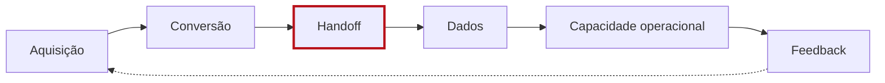

# Motor de Receita

Seis etapas, sempre nesta ordem e com estes nomes: **Aquisição, Conversão, Handoff, Dados, Capacidade operacional, Feedback.** Use `RevenueEngine` para desenhar e marque **um** gargalo por peça. Casos seguem `CaseFlow`: **contexto → gargalo → integração → decisão → efeito na receita**.

Caso modelo (CaseFlow): **Aurum Advisory**, evento de investimentos. Gargalo: expositores captam volume sem qualificar. Integração: formulário condicional por perfil ligado ao follow-up. Decisão: tratar o evento como o começo da operação. Efeito: **R$ 200 mil** em receita direta em 30 dias, 117 leads qualificados (36%).

---

**Mapa:** [[00 Mapa da Marca]]

**Relacionadas:**
- [[03 Território, Tese e Inimigo]]
- [[09 Founder Led Growth]]
